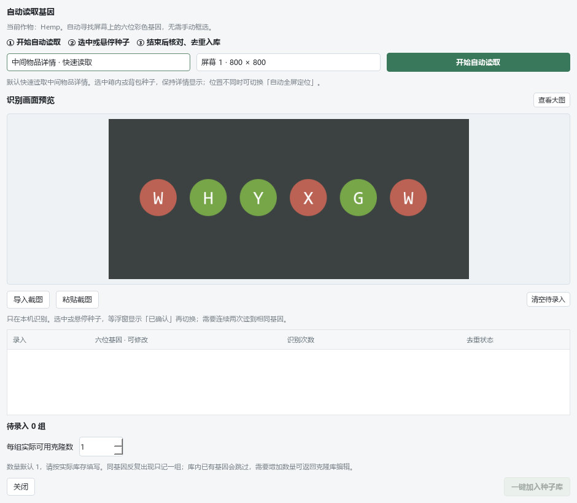
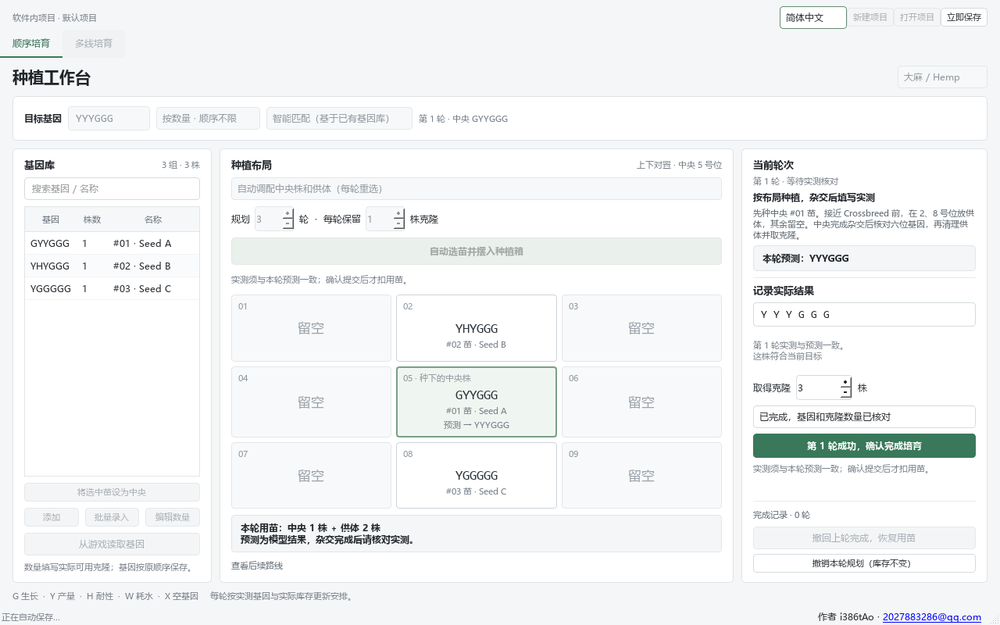
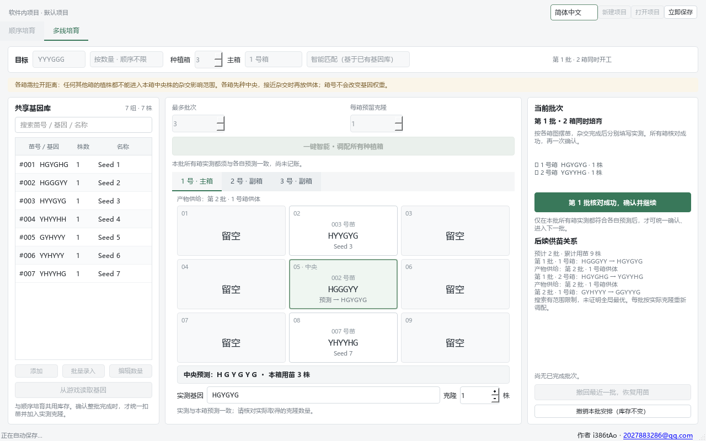

[简体中文](README.md) · [English](README.en.md) · [Русский](README.ru.md)

# Rust 种养殖小工具

**Rust Growing Toolkit · V3.0.5 · Windows 桌面版**

根据已有克隆苗的六位基因和实际数量，寻找《Rust》配种路线。支持顺序培育、多箱并行培育、屏幕基因识别和软件内项目自动保存。作者：**i386tAo** · [2027883286@qq.com](mailto:2027883286@qq.com)。

## V3.0.5 逐字形识别

- 游戏基因优先逐个识别 G、Y、H、W、X，再按原位置组成六位基因，减少整行文字识别因组合不同而漏字的问题。
- 字形、颜色与完整六位校验通过后才采纳；不确定时保留系统 OCR 后备识别。自动采集仍需两次确认，重复识别不增加库存。
- 修复空结果被持续缓存的问题：一次未识别成功后，保持同一画面也会继续尝试。

## V3.0.4 识别修复

- 修复切到第二株后整行漏读的问题，真实游戏样本 `XYHYXH` 现可正确读取。
- 首次识别完全没有文字时，自动调整字形大小后重试一次；继续保留六位、颜色与连续两次采集校验，重复识别不会增加库存。

## V3.0.3 识别改进

- 放大截图预览，随窗口调整大小；双击或点击“查看大图”，支持原图、2 倍、4 倍核对。
- 修复小字在部分缩放比例下的漏读：首次无法读出完整六位时追加一次识别，仍须通过六位字母和颜色校验。
- 预览缩放不影响识别输入，识别始终使用原始截图；结果请在入库前核对。



## V3.0.2 修复

- 项目或项目列表异常时保留原文件，并尝试从匹配的自动保存恢复；无法恢复时暂停保存，避免空白状态覆盖已有数据。
- 修复多线培育连续重新规划时中间苗编号冲突，导致后续批次无法继续的问题。
- 修复关闭识别窗口后，延迟的框选操作可能重新弹出窗口的问题。
- 顺序规划不再推荐当前流程无法执行的无供体中间步骤。
- 修复后台计算在接收大种子库时取消不及时，以及切换语言后作物名称未更新的问题。

## 商业使用

未经作者 i386tAo 许可，不得将本软件用于商业用途。商业授权请联系 [2027883286@qq.com](mailto:2027883286@qq.com)。三语声明见 [LICENSE.md](LICENSE.md)。

## 开始使用

**[下载 Windows 便携版](https://github.com/tAoi386/Rust_agri-utils/releases/latest)**：在发行版页面选择 `Rust_agri-utils-Windows-v*.zip`，解压后运行其中的 `RustSeedLab.exe`。

项目仓库：[tAoi386/Rust_agri-utils](https://github.com/tAoi386/Rust_agri-utils)。在 GitHub 选择 **Code → Download ZIP** 可下载源码；解压到 `Rust_agri-utils` 目录，按下文准备 Python 后运行 `launch.bat`。也可以克隆仓库：

```powershell
git clone https://github.com/tAoi386/Rust_agri-utils.git
cd Rust_agri-utils
.\launch.bat
```

本地已经构建便携版时，双击 **`启动种养殖工具.bat`**；旧入口 `启动苗圃.bat` 保留兼容。源码目录中的程序路径为 `dist\capture\RustSeedLab\RustSeedLab.exe`。如果拿到的是便携压缩包，解压后直接运行其中的 `RustSeedLab.exe`；复制到其他电脑时保留整个 `RustSeedLab` 文件夹。便携版不需要安装 Python。

通常无需管理员权限；若无法启动，可尝试右键选择“以管理员身份运行”。

程序支持 **简体中文、English、Русский** 界面切换。日常使用“新建项目”“打开项目”管理软件内项目，修改会自动保存，无需选择保存文件夹。“立即保存”可主动保存当前内容。

一个项目使用一种作物。录入已知六位基因、实际可用的克隆数量和名称；普通未知种子先在游戏里种下查看基因。苗号在两个培育页面中保持一致。默认目标为 **3G3Y，顺序不限**，例如 `GGYYYG`、`YGYGYG` 都符合；也可设置固定顺序目标。

## 界面预览

以下截图使用匿名演示数据，分别展示顺序培育和多线培育。图中的预测是规划结果，仍需在游戏中逐轮或逐批核对实测。

**顺序培育**



**多线培育**



## 两种培育方式

### 顺序培育

1. 录入或读取基因库，选择目标、最多规划轮数和预计每轮取得的克隆数。
2. 选择规划取舍：“优先杂交轮数最少”“优先总用苗最少”或 **“智能匹配（基于已有基因库）”**。自动模式会一起比较中央株和周围供体，也可以固定中央株。
3. 点击自动选苗。只有找到完整达标路线，才会安排第一轮布局；没有完整路线时会说明搜索结果，并显示短暂浮层提示。
4. 按图种植：先种中央 5 号位，接近杂交阶段时再放指定供体，空位保持空。中央格显示要种的苗号、当前基因和预测生成的基因。
5. 杂交完成并取得克隆后，输入实际六位基因与实际数量。逐位核对成功后确认本轮；软件扣除安排的用苗，加入实测克隆，再根据实际库存规划下一轮。

界面预测不等于已取得的植物。**实测必须逐位符合本轮预测，才能确认并进入下一轮。** 最终目标“顺序不限”不会放宽本轮预测的逐位核对。不一致时先核对生长阶段、用苗及布局，软件保持库存不变。已有目标克隆会提示直接保留，无需继续杂交。

### 多线培育

设置 **2–6 个种植箱**及主箱，默认 3 箱、1 号为主箱，再点击“一键智能”。主箱用于目标路线，副箱可以提前培育后续需要的中央株或供体。各箱有独立布局、预测、实测输入和克隆数量；供苗关系会说明产物用于后续哪一批、哪一个箱。

同一批安排的所有箱使用同一份实际库存。软件不会把一株苗同时分配给两个箱，也不会把本批尚未产出的克隆用于同批其他箱。**所有使用中的箱都核对成功后，才一次确认整批、统一记账并按实测重新调配下一批。** 不需要的箱会空置。

**各箱必须拉开距离，避免其他箱的植株进入本箱中央株的杂交影响范围。** 软件常驻显示这个提醒；箱号和四角、上下左右的位置不会额外增加基因权重。仍需按游戏中的实际距离和生长阶段核对操作。

多箱可以并行准备中间苗，但不保证“三箱必定两批达标”。预计批数是方案的依赖批次，不是分钟计时，也不承诺实际成熟时间最短。是否能合成目标，取决于已录入的基因、数量、预计克隆产出和搜索范围。

## 识别与库存

**开始基因识别前，请将 Rust 切换为窗口模式，并保持基因详情可见，完整显示六位基因字母。**

“从游戏读取基因”读取当前屏幕的基因画面，无需录制视频。读取期间主窗口隐藏，结束后展开。默认查找屏幕中间的物品详情；需要时可调整范围或导入截图。将游戏物品的六位基因完整显示，等待确认后再换下一株，最后核对识别列表再入库。

识别需要 Windows 10/11 可用的 Windows OCR 组件，在本机处理画面，不读取游戏内存、不自动操作游戏。字母模糊、遮挡或背景干扰可能造成误识别，请核对结果；OCR 不可用时仍能手动或批量录入。

去重按**原顺序完全相同的六位基因**判断。重复识别不会自动增加库存；实际新增了同基因克隆，请调整其可用数量。库存数量表示可用于后续安排的真实苗数，不是基因样本出现次数。

## 自动保存与撤回

项目保存在程序旁的 `data/projects/`，最近工作状态保存在 `data/autosave.json`。保存包含库存、苗号、目标、培育模式、箱数、已安排的本轮/本批、实测草稿和完成记录。重新打开可继续工作。请将便携版放在可写目录；备份或迁移时一起复制 `data/`。

放在程序旁的旧版 JSON 项目会在启动时导入软件内项目列表，原文件保留。匿名演示和自己的项目应分别管理，避免将演示库存误当作游戏里的真实余量。

规划预览不扣苗，确认实测才记账。顺序培育可撤回最近一轮，多线培育可撤回最近一批；撤回恢复该次用苗并撤销其新增克隆，只更正软件记录。完成后若库存又变化，软件会阻止覆盖这些变动。也可撤销尚未确认的安排。存在待完成安排时，另一种培育模式及库存编辑会锁定，避免重复用苗。

日志仅保存在本机：`data/logs/runtime.log`、`data/logs/native-crash.log`。目录不可写时会尝试临时目录中的 `RustSeedLab/logs`，不会自动上传。

## 匿名演示

[examples/parallel.json](examples/parallel.json) 是无私人数据、无已执行安排的三箱演示项目。也可新建项目，将下列内容批量录入，每项 1 株，使用 3G3Y 顺序不限目标：

```text
HGYGHG 1 Demo01
HGGGYY 1 Demo02
HYYGYG 1 Demo03
YHYYHH 1 Demo04
GYHYYY 1 Demo05
YYHYYY 1 Demo06
YHYYHG 1 Demo07
```

这组样本存在模型内的两批分叉路线：两箱分别准备中间苗，再在主箱合并得到 `GGYYYG`。它用于演示共享库存和供苗依赖；软件可能找到另一条完整路线，实际培育仍须逐批填写游戏结果。

## 规划边界

- `G` 生长、`Y` 产量、`H` 耐性、`W` 耗水、`X` 空基因。空种植格不等于带 `X` 基因的植物。
- 九宫格中央为受体，每箱最多 8 株供体；按对应基因位置计算。布局帮助摆苗，换箱号或角落位置不会改变同一组供体的模型计票。
- 搜索受时间、组合数和候选范围限制。“暂未找到方案”不等于已经证明样本不足或目标不可达；“当前找到的较省路线”不代表所有可能路线的全局最优。
- 推演只使用模型确定的中间产物，且逐批核对库存。预计克隆产出只是规划假设，确认时一律使用实际取得数量。
- 本工具不替玩家种植、移除或取克隆。模型与测试不能代替游戏实测；游戏版本、服务器规则、距离及操作时间可能影响结果。本项目并非 Facepunch 官方产品。

## 从源码运行与构建

需要 Python **3.10+**。双击 `launch.bat` 启动源码；依赖缺失时会安装到项目 `.deps/`，首次安装需要网络。也可以在项目根目录运行：

```powershell
python -m pip install --target .deps -r requirements.txt
$env:PYTHONPATH = "$PWD;$PWD\.deps"
python main.py
```

运行检查：

```powershell
python -m unittest discover -s tests -v
```

双击 `build.bat` 构建便携版。构建依赖安装在 `.build-deps/`；暂存目录为 `dist/build-new/`，当前程序目录为 `dist/capture/RustSeedLab/`。更新前关闭运行中的程序；构建保留 `data/`，旧便携目录备份到 `artifacts/portable-build-backups/`。

发布前运行已构建程序的 `--smoke-test`，确认当前版本检查通过，再运行 `python tools/package_release.py`。发布包会排除私人库存、自动保存和日志，并携带三方依赖声明 `third-party-notices/`。源码仓库中的 `.gitignore` 排除本地数据、构建产物及缓存；请勿将个人项目或含私人信息的截图加入公开仓库。
