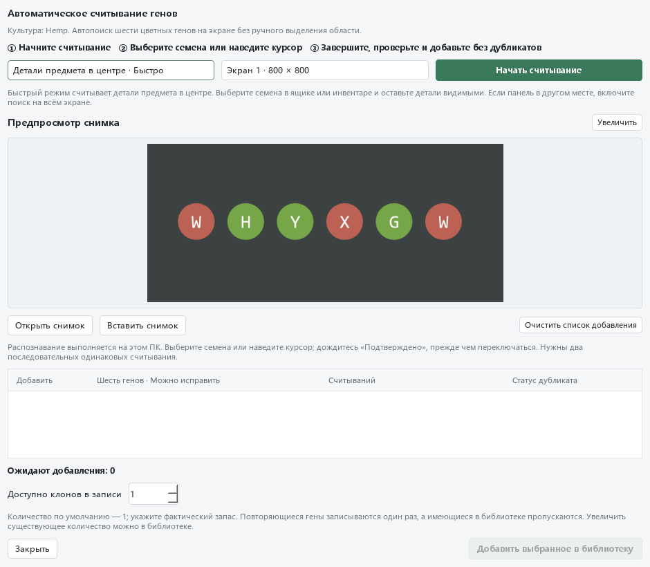
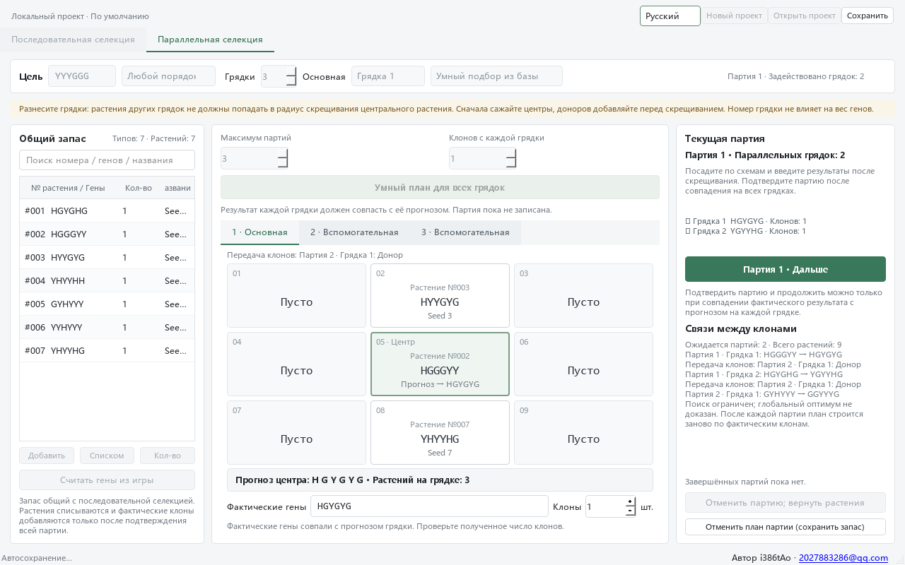

[简体中文](README.md) · [English](README.en.md) · [Русский](README.ru.md)

# Rust Growing Toolkit

**V3.0.4 · Приложение для Windows**

Помощник по скрещиванию растений в Rust. Он ищет путь к нужным генам по шестибуквенным генотипам и реальному количеству имеющихся клонов. Поддерживаются последовательное выращивание, параллельная работа нескольких грядок, распознавание генов с экрана и автосохранение локальных проектов. Автор: **i386tAo** · [2027883286@qq.com](mailto:2027883286@qq.com).

## Исправление распознавания V3.0.4

- Исправлен пропуск строки генов после переключения на другое растение; проверено на реальном игровом образце `XYHYXH`.
- Если первая попытка не находит текста, размер изображения букв изменяется и выполняется одна повторная попытка. Проверки шести букв, цветов и двух последовательных снимков сохранены; повторное распознавание не увеличивает запас.

## Улучшения распознавания V3.0.3

- Увеличен предпросмотр снимка с изменяемым размером. Двойной щелчок или кнопка «Увеличить» открывает исходное изображение с масштабом 1×, 2× или 4×.
- Исправлены пропуски мелкого текста при некоторых масштабах интерфейса. Дополнительная попытка выполняется только если первая не распознала полную последовательность из шести генов; проверка букв и цветов сохраняется.
- Масштаб предпросмотра не изменяет исходный снимок для распознавания. Перед импортом проверьте результат.



## Исправления V3.0.2

- Повреждённые проекты и списки проектов сохраняются; восстановление использует только соответствующее автосохранение. При неудаче сохранение приостанавливается, чтобы пустой рабочий стол не затёр данные.
- Исправлены конфликты идентификаторов промежуточных клонов при повторном планировании, мешавшие продолжить следующие партии.
- Исправлено повторное открытие окна захвата отложенным выбором области после его закрытия.
- Последовательные планы больше не включают промежуточные шаги без доноров, которые текущий рабочий процесс не может выполнить.
- Исправлены задержка отмены при передаче большой библиотеки фоновому расчёту и названия культур, остававшиеся на прежнем языке.

## Коммерческое использование

Использование этой программы в коммерческих целях без разрешения автора i386tAo запрещено. По вопросам разрешения на коммерческое использование обращайтесь: [2027883286@qq.com](mailto:2027883286@qq.com). Заявление на трёх языках приведено в [LICENSE.md](LICENSE.md).

## Начало работы

**[Скачать портативную версию для Windows](https://github.com/tAoi386/Rust_agri-utils/releases/latest)**: на странице выпуска выберите `Rust_agri-utils-Windows-v*.zip`, распакуйте архив и запустите вложенный `RustSeedLab.exe`.

Репозиторий: [tAoi386/Rust_agri-utils](https://github.com/tAoi386/Rust_agri-utils). Пункт **Code → Download ZIP** на GitHub скачивает исходный код. Распакуйте его в `Rust_agri-utils`, подготовьте Python по инструкции ниже и запустите `launch.bat`. Либо клонируйте репозиторий:

```powershell
git clone https://github.com/tAoi386/Rust_agri-utils.git
cd Rust_agri-utils
.\launch.bat
```

Если портативная сборка уже создана локально, используйте **`启动种养殖工具.bat`**; прежний файл запуска `启动苗圃.bat` также работает. В дереве исходного кода программа находится в `dist\capture\RustSeedLab\RustSeedLab.exe`. Если у вас портативный архив, распакуйте его и откройте вложенный `RustSeedLab.exe` напрямую. Для переноса скопируйте всю папку `RustSeedLab`. Устанавливать Python для портативной версии не нужно.

Обычно права администратора не требуются. Если программа не запускается, можно попробовать щёлкнуть по ней правой кнопкой мыши и выбрать **«Запуск от имени администратора»**.

Интерфейс переключается между **упрощённым китайским, английским и русским**. Создавайте и открывайте проекты внутри приложения. Изменения сохраняются автоматически, без выбора папки. Кнопка немедленного сохранения записывает текущие данные сразу.

Один проект предназначен для одной культуры. Введите известные гены, название и фактическое количество доступных клонов. Неизвестные семена сначала посадите в игре и прочитайте их гены. Номера саженцев одинаковы в обоих режимах. Цель по умолчанию — **3G3Y в любом порядке**: подойдут и `GGYYYG`, и `YGYGYG`. Также можно задать точный порядок генов.

## Обзор интерфейса

На снимках использованы обезличенные демонстрационные данные для последовательного и параллельного выращивания. Прогнозы показывают план; фактические результаты игры необходимо проверять после каждого раунда или партии.

**Последовательное выращивание**


**Параллельное выращивание**



## Два режима выращивания

### Последовательное выращивание

1. Заполните библиотеку генов вручную или распознаванием. Укажите цель, глубину планирования и ожидаемый выход клонов за раунд.
2. Выберите приоритет: меньше раундов, меньше расход растений или **умный подбор по имеющейся библиотеке генов**. Автоматический режим совместно выбирает центральное растение и доноров; центральное растение можно закрепить вручную.
3. Запустите подбор. Схема первого раунда появится только после нахождения полного пути к цели. Если поиск не дал результата, приложение укажет ограничения и покажет краткое всплывающее сообщение.
4. Следуйте схеме: сначала посадите центральное растение в ячейку 5. Добавьте нужных доноров, когда оно приблизится к стадии скрещивания; незанятые ячейки оставьте пустыми. В центральной ячейке показаны номер саженца, исходные гены и прогноз результата.
5. После завершения скрещивания и получения клонов введите фактические шесть генов и количество клонов. После проверки подтвердите раунд. Приложение спишет использованные растения, добавит реальные клоны и пересчитает следующий раунд по текущему запасу.

Прогноз не означает, что растение уже получено. **Фактические гены должны совпадать с прогнозом по каждой позиции, прежде чем можно подтвердить следующий раунд.** Свободный порядок конечной цели не отменяет эту проверку. При расхождении проверьте стадию роста, растения и схему: запас не изменяется. Если подходящий клон уже есть, его можно просто оставить без нового скрещивания.

### Параллельное выращивание

Укажите **от 2 до 6 грядок** и выберите главную. По умолчанию используются три грядки, главная — № 1. Общий план может заранее выращивать будущие центральные растения или доноров на вспомогательных грядках. У каждой грядки есть своя схема, прогноз, поле фактических генов и количество клонов. Подсказки показывают, в какой следующей партии и на какой грядке понадобится результат.

Все грядки одной партии используют общий реальный запас. Один саженец нельзя одновременно назначить двум грядкам. Клон, который ещё только должен вырасти в текущей партии, нельзя использовать в другой грядке той же партии. **Подтвердить партию можно только после успешной проверки всех задействованных грядок.** Учёт выполняется целиком за партию, затем следующий план рассчитывается по фактическому выходу. Ненужные грядки остаются пустыми.

**Разносите грядки так, чтобы растения одной грядки не попадали в радиус влияния на центральное растение другой.** Напоминание постоянно видно. Номер грядки и положение донора в углу или у края не добавляют веса его генам. Проверяйте расстояния и стадии роста в самой игре.

Несколько грядок позволяют одновременно готовить промежуточные клоны, но три грядки не гарантируют результат за две партии. Число партий описывает зависимости плана, а не время в минутах и не минимальный срок созревания. Возможность получить цель зависит от генов, количества растений, ожидаемого выхода клонов и охвата поиска.

## Распознавание и запас

**Перед распознаванием генов переключите Rust в оконный режим и оставьте описание генов видимым: все шесть букв должны отображаться полностью.**

Чтение генов из игры обрабатывает изображение на экране, запись видео не нужна. На время захвата главное окно скрывается и возвращается после завершения. По умолчанию распознаётся область описания предмета около центра экрана; можно изменить область или загрузить изображение. Покажите все шесть генов, дождитесь подтверждения, перейдите к следующему растению и проверьте список перед добавлением.

Используются локальные компоненты Windows OCR в Windows 10/11. Приложение не читает память игры и не управляет игровыми действиями. Размытие, перекрытие букв и фоновые эффекты могут привести к ошибкам. Проверяйте результат; при недоступном OCR остаётся ручной и пакетный ввод.

Дубликаты определяются по **полному шестибуквенному генотипу с сохранением порядка**. Повторное распознавание не увеличивает запас. Если получены новые клоны уже известного генотипа, измените доступное количество. Количество означает реальные растения для будущих назначений, а не число обнаружений генотипа.

## Сохранение и отмена

Проекты находятся в `data/projects/` рядом с программой; последнее рабочее состояние — в `data/autosave.json`. Сохраняются запас, номера саженцев, цель, режим, настройки грядок, незавершённые назначения, введённые результаты и история. Размещайте программу в папке с правом записи. При резервном копировании и переносе включайте `data/`.

Старые проекты JSON, помещённые рядом с программой, при запуске импортируются во внутренний список; исходные файлы сохраняются. Держите демонстрационные проекты отдельно от реальных запасов, чтобы не принять примерные количества за имеющиеся растения.

Просмотр плана ничего не списывает. Учёт меняется только после подтверждения фактического результата. Можно отменить последний завершённый раунд или последнюю партию: восстановить использованные растения и убрать добавленные клоны из программного учёта. Это не изменяет растения в игре. Если запас после завершения уже изменился, приложение не позволит затереть эти изменения отменой. Неподтверждённый план также можно отменить. Пока есть незавершённое назначение, другой режим и редактирование запаса блокируются, чтобы не распределить одни растения дважды.

Журналы хранятся локально: `data/logs/runtime.log` и `data/logs/native-crash.log`. Если папка недоступна для записи, используется попытка сохранения в `RustSeedLab/logs` во временном каталоге Windows. Автоматической отправки журналов нет.

## Обезличенный пример

[examples/parallel.json](examples/parallel.json) содержит пример для трёх грядок без личных данных и назначенных посадок. Можно создать проект и вставить следующие строки пакетным вводом — по одному клону каждого генотипа, цель 3G3Y в любом порядке:

```text
HGYGHG 1 Demo01
HGGGYY 1 Demo02
HYYGYG 1 Demo03
YHYYHH 1 Demo04
GYHYYY 1 Demo05
YYHYYY 1 Demo06
YHYYHG 1 Demo07
```

В модели для этого набора существует план из двух партий: две грядки готовят промежуточные клоны, затем главная объединяет их для получения `GGYYYG`. Пример показывает общий учёт и зависимости между грядками. Поиск может предложить другой полный путь; результаты игры всё равно необходимо вводить после каждой партии.

## Ограничения планирования

- `G` — рост, `Y` — урожайность, `H` — выносливость, `W` — потребление воды, `X` — пустой ген. Пустая ячейка грядки не является растением с генами `X`.
- Реципиент находится в центре сетки 3 × 3; доноров может быть не более восьми. Сравниваются соответствующие позиции генов. Схема помогает расставить растения, но перестановка тех же подходящих доноров между углами и краями не меняет модельный вес голосов.
- Поиск ограничен временем, числом комбинаций и отбором кандидатов. Отсутствие найденного пути не доказывает недостаточность библиотеки или недостижимость цели. Найденный экономичный план не является доказательством глобального оптимума.
- Для будущих партий используются определённые моделью промежуточные результаты с проверкой запаса. Ожидаемый выход клонов — допущение; при подтверждении учитывается только фактически полученное количество.
- Приложение не сажает растения, не убирает их и не берёт клоны вместо игрока. Модель и тесты не заменяют наблюдения в игре. На результат могут влиять версия игры, правила сервера, расстояния и время действий. Это не официальный продукт Facepunch.

## Запуск исходного кода и сборка

Требуется Python **3.10+**. Для запуска исходного кода используйте `launch.bat`. Недостающие зависимости устанавливаются в `.deps/` внутри проекта; первая установка требует сети. Либо выполните в корне репозитория:

```powershell
python -m pip install --target .deps -r requirements.txt
$env:PYTHONPATH = "$PWD;$PWD\.deps"
python main.py
```

Запуск проверок:

```powershell
python -m unittest discover -s tests -v
```

`build.bat` создаёт портативную сборку. Зависимости сборки находятся в `.build-deps/`, промежуточный результат — в `dist/build-new/`, текущая программа — в `dist/capture/RustSeedLab/`. Перед обновлением закройте приложение. Обновление сохраняет `data/` и переносит предыдущую папку программы в `artifacts/portable-build-backups/`.

Перед упаковкой запустите собранный исполняемый файл с `--smoke-test` и проверьте успешный результат для текущей версии. Затем выполните `python tools/package_release.py`. Архивы не включают личные запасы, автосохранения и журналы; сведения о сторонних зависимостях находятся в `third-party-notices/`. `.gitignore` исключает локальные данные, результаты сборки и кэши. Не добавляйте личные проекты и снимки экрана с частными данными в публичный репозиторий.
